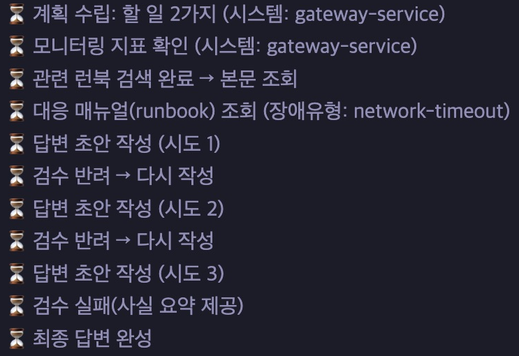
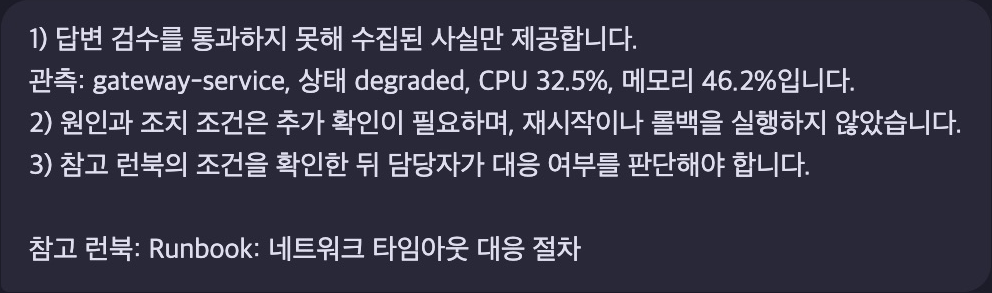

# 운영 장애 대응 Agent 개선

**과제 1 | 조사 대상 확인, 런북 검색, 답변 검수**

사용자의 장애 증상과 모니터링 알림으로 대응 매뉴얼을 찾고, 수치와 조치 조건을 검사한 답변을 제공합니다. 기존 LangGraph와 MCP 연결을 활용해 대상 확인부터 최종 답변까지의 흐름을 보완했습니다.

[개선 내용](#개선-내용) | [실행 화면](#실행-화면) | [처리 흐름](#처리-흐름) | [실행](#실행) | [검증](#검증) | [주요 코드](#주요-코드)

## 개선 내용

| 영역 | 기존 방식 | 개선 내용 |
|---|---|---|
| 조사 대상 | 대상이 불명확하거나 미등록 이름이면 다른 서비스가 조회될 수 있음 | 조회 전에 대상을 확인하고, 답변을 받으면 원래 장애 증상으로 분석 재개 |
| 런북 선택 | 알림의 영어 키워드로 문서 하나를 선택하고, 일치하지 않으면 DB 장애 문서 사용 | 사용자 증상과 알림을 RAG로 검색하고, 증상별 근거가 있을 때 최대 두 문서 활용 |
| 답변 검수 | 수치 오류나 조치의 전제 조건 누락을 충분히 검사하기 어려움 | 수치와 일부 조치 조건을 검사해 재작성하고, 반복 실패 시 관측 사실 안내 |
| 화면 표시 | 검수 중인 장애 답변 초안도 화면에 표시 | 최종 답변만 표시하고 참고 런북 제목 제공 |

예를 들어 `billing-service 메모리 누수를 진단해주세요`라고 요청하면 지원하는 시스템을 다시 묻습니다. 같은 대화에서 `cache-service를 조사해주세요`라고 답하면 대상만 바꾸고 메모리 누수 증상은 유지합니다.

## 실행 화면

**요청:** gateway-service 네트워크 타임아웃 장애를 진단해주세요

### 런북 조회와 검수 과정



네트워크 타임아웃 런북 하나를 조회했습니다. 관계없는 DB 런북은 추가하지 않았습니다.

### 최종 응답



실제 Ollama 실행에서 세 차례 답변이 모두 반려되어, 관측 사실과 참고 런북을 안내한 결과입니다.

## 처리 흐름


- **RAG 검색:** E5 다국어 모델로 문서와 요청을 임베딩하고 유사도로 순위를 계산합니다. 문서 벡터는 서버 시작 시 메모리에 준비해 재사용합니다. 검색에 실패하면 키워드 방식으로 대체하고 이를 안내합니다.
- **문서 추가 조건:** 기본은 전체 요청의 1순위 문서입니다. 전체 1위와 2위 문서가 각각 증상별 검색에서도 1위로 선택될 때만 두 문서를 사용합니다.
- **MCP 조회:** 선택한 문서 식별자로 기존 MCP Resource의 본문을 읽어 답변 작성에 전달합니다.
- **검수와 종료:** 최초 작성을 포함해 최대 세 번 작성합니다. 세 번째에도 반려되면 관측 사실을 제공합니다.

## 실행

### 준비

| 항목 | 사용 환경 |
|---|---|
| Python | 3.11에서 검증 |
| Ollama | 로컬 서비스 실행 필요 |
| 답변 모델 | 검증에 사용한 `qwen2.5:0.5b` |
| 임베딩 모델 | `intfloat/multilingual-e5-small` |
| Node.js | 화면 이벤트 테스트에만 18 이상 필요 |

프로젝트 루트에서 의존성과 모델을 준비합니다. Ollama 데스크톱 앱을 사용하지 않는 경우, 먼저 별도 터미널에서 `ollama serve`를 실행합니다.

```sh
bash sh/setup_venv.sh
ollama pull qwen2.5:0.5b
```

> [!NOTE]
> E5 임베딩 모델은 최초 실행 시 내려받습니다. 다운로드와 문서 벡터 준비가 끝난 뒤 서버를 사용할 수 있습니다.

### 백엔드

```sh
LANGSMITH_TRACING=false LANGCHAIN_TRACING_V2=false \
LLM_BACKEND=ollama SUPERVISOR_VERSION=v2 RUNBOOK_SEARCH_MODE=rag \
OLLAMA_FAST_MODEL=qwen2.5:0.5b OLLAMA_QUALITY_MODEL=qwen2.5:0.5b \
.venv/bin/python server.py
```

### 채팅 화면

다른 터미널에서 실행합니다.

```sh
.venv/bin/python web_demo_server.py
```

채팅 화면은 **http://localhost:8600**, 서버 상태는 **http://localhost:8100/health**에서 확인합니다. 위 직접 실행 명령은 기존 세션 DB를 삭제하지 않습니다.

### 예시 요청

```text
gateway-service 네트워크 타임아웃 장애를 진단해주세요
payments-service CPU 급증과 cache-service 메모리 누수 장애를 함께 진단해주세요
```

모델 설정, 키워드 방식 전환과 런북 추가 방법은 [실행·개발 안내](doc/RAG_GUIDE.md)를 참고합니다. 추적이나 OpenAI 연결을 사용할 때의 설정은 [환경변수 예시](.env.example)에 있으며, 실제 키는 Git에서 제외된 `.env`에 보관합니다.

## 검증

| 구분 | 결과 | 확인 내용 |
|---|---|---|
| Python unittest | 62개 통과 | 대상 확인, 후속 질문 연결, 런북 검색, 답변 검수와 기존 기능 회귀 |
| 화면 이벤트 테스트 | 2개 통과 | 검수 중인 초안 숨김, 일반 대화 스트리밍과 최종 답변 표시 |
| 실제 모델 연결 | 실행 확인 | E5 검색, MCP 본문 조회와 Ollama 응답, 반복 반려 후 사실 요약 |

```sh
.venv/bin/python -m unittest discover -s tests -q
node --test tests/test_web_stream.cjs
.venv/bin/python -m compileall -q agent eval tests server.py
.venv/bin/python -m pip check
```

화면 이벤트 테스트는 Node.js 내장 도구를 사용하므로 별도 npm 패키지가 필요하지 않습니다. 실제 모델 실행에서는 관련 런북을 조회했지만 답변이 세 차례 반려돼 관측 사실을 제공한 사례도 확인했습니다.

### 검색 비교 재현

같은 고정 평가 자료로 키워드 방식과 RAG 검색을 비교합니다. 아래 명령의 파이프라인은 실제 LangGraph에 fake LLM과 고정 MCP 어댑터를 연결한 구성입니다.

```sh
.venv/bin/python -m eval.run_eval --pipeline --output eval/results/evaluation.json
```

생성한 결과 JSON은 Git에서 제외합니다. 측정 조건과 지표 해석은 [평가 재현 안내](doc/RAG_GUIDE.md)에 정리했습니다.

## 주요 코드

| 경로 | 역할 |
|---|---|
| [agent/system_targets.py](agent/system_targets.py) | 지원 시스템 확인과 원래 장애 증상 복원 |
| [agent/runbook_search.py](agent/runbook_search.py) | 문서 로딩, 임베딩과 런북 선택 |
| [agent/answer_grounding.py](agent/answer_grounding.py) | 수치와 조치 조건 검사, 관측 사실 요약 |
| [agent/graph.py](agent/graph.py) | 조사, MCP 조회, 답변 작성과 검수 분기 |
| [server.py](server.py), [agent/deps.py](agent/deps.py) | 검색기 초기화와 의존성 전달 |
| [agent/mcp_client.py](agent/mcp_client.py), [mcp_server.py](mcp_server.py) | 기존 MCP 연결과 런북 본문 조회 |
| [data/](data/) | 런북 6개와 샘플 모니터링 자료 |
| [tests/](tests/), [eval/](eval/) | 기능 및 회귀 테스트와 고정 검색 평가 |

## 확인 범위와 한계

현재 런북은 6개이며 모니터링은 샘플 자료입니다. 별도 벡터 DB 없이 메모리에서 검색하고, 나열 표현이 없는 복합 증상은 추가 문서 선택에서 놓칠 수 있습니다.

답변 검수는 백분율과 지표 수치, 일부 조치 조건을 검사합니다. 모든 자연어 오류를 검출하지는 못하며, 의미가 같은 다른 표현도 반려될 수 있습니다. 관련 문서 검색과 생성 답변의 정확성은 구분해 확인해야 합니다.
